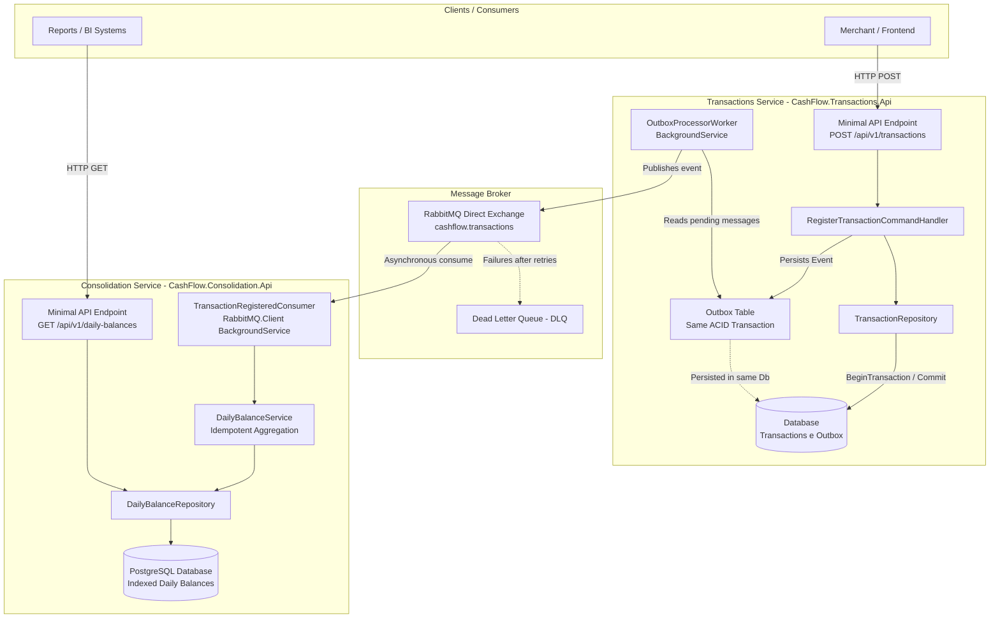
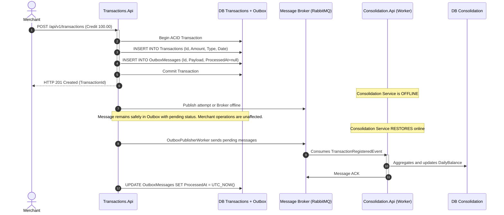

# Cash Flow and Daily Consolidation Design

**Spec**: `.specs/features/fluxo-caixa-consolidado/spec.md`  
**Status**: Approved  

---

## Architecture Overview

The system adopts **Approach 1: Two Autonomous Services with Asynchronous Messaging and the Transactional Outbox Pattern**.

All codebase classes, interfaces, entities, records, and projects use **English** naming conventions following .NET idiomatic practices.

The architecture ensures strict physical and logical decoupling:
1. **`CashFlow.Transactions.Api`**: Handles incoming financial transaction requests (credits and debits), validating data and writing the `Transaction` entity alongside an `OutboxMessage` within the same local ACID transaction. An asynchronous background worker (`OutboxProcessorWorker`) dispatches pending messages to the broker (`RabbitMQ` via official `RabbitMQ.Client v7` driver).
2. **`CashFlow.Consolidation.Api`**: Asynchronously consumes `TransactionRegisteredEvent` messages through an idempotent consumer (`TransactionRegisteredConsumer`), aggregating and updating the daily consolidated balance (`DailyBalance`). The read endpoint provides sub-5ms query responses using indexed PostgreSQL queries, easily satisfying the 50 req/s throughput requirement.

Even if the Consolidation service or the message broker is completely unavailable, merchants can continue registering transactions without interruption.



### Resilience Sequence (Consolidation Service Offline)



---

## Code Reuse Analysis

### Greenfield Solution
As a new solution, there is no legacy internal code. Standard Microsoft .NET and widely accepted industry packages are leveraged:

| Package / Library | Purpose | Usage |
| ----------------- | ------- | ----- |
| `Microsoft.AspNetCore.OpenApi` / `Swashbuckle` | Interactive API documentation | OpenAPI / Swagger generation for both services |
| `FluentValidation` | Decoupled input validation | Validates HTTP requests and command contracts |
| `RabbitMQ.Client` | Native async messaging driver | Resilient async publishing and idempotent event consumption |
| `Microsoft.EntityFrameworkCore` | ORM & Relational Data Access | Migrations, entity mapping, and transactional control |
| `xUnit` + `FluentAssertions` + `Moq` | Automated Test Suite | High-readability unit and integration tests |

---

## Components

### 1. `CashFlow.Transactions` Module

#### `Transaction` (Domain Entity)
- **Purpose**: Aggregate root representing a financial transaction, enforcing positive amounts and business invariants.
- **Location**: `src/Transactions/CashFlow.Transactions.Domain/Entities/Transaction.cs`
- **Interfaces**:
  - `CreateCredit(decimal amount, DateOnly date, string description): Transaction`
  - `CreateDebit(decimal amount, DateOnly date, string description): Transaction`
- **Dependencies**: None (Pure Domain).

#### `ITransactionRepository` (Domain Repository Interface)
- **Purpose**: Contract for storing and querying transactions.
- **Location**: `src/Transactions/CashFlow.Transactions.Domain/Repositories/ITransactionRepository.cs`
- **Interfaces**:
  - `Task AddAsync(Transaction transaction, CancellationToken ct)`
  - `Task<Transaction?> GetByIdAsync(Guid id, CancellationToken ct)`

#### `IOutboxRepository` (Infrastructure Repository Interface)
- **Purpose**: Contract for persisting and retrieving transactional outbox messages.
- **Location**: `src/Transactions/CashFlow.Transactions.Domain/Repositories/IOutboxRepository.cs`
- **Interfaces**:
  - `Task AddMessageAsync(OutboxMessage message, CancellationToken ct)`
  - `Task<IReadOnlyList<OutboxMessage>> GetPendingMessagesAsync(int batchSize, CancellationToken ct)`
  - `Task MarkAsProcessedAsync(Guid messageId, CancellationToken ct)`

#### `OutboxPublisherWorker` (Background Worker)
- **Purpose**: Background hosted service that polls pending outbox messages and dispatches them to MassTransit with exponential backoff.
- **Location**: `src/Transactions/CashFlow.Transactions.Infrastructure/BackgroundServices/OutboxPublisherWorker.cs`
- **Dependencies**: `IOutboxRepository`, `IPublishEndpoint` (MassTransit), `ILogger`.

---

### 2. `CashFlow.Consolidation` Module

#### `DailyBalance` (Domain Entity)
- **Purpose**: Aggregate entity maintaining total credits, debits, net balance, and transaction count per date.
- **Location**: `src/Consolidation/CashFlow.Consolidation.Domain/Entities/DailyBalance.cs`
- **Interfaces**:
  - `AddCredit(decimal amount)`
  - `AddDebit(decimal amount)`
  - `RecalculateNetBalance()`
- **Dependencies**: Pure Domain.

#### `TransactionRegisteredConsumer` (Messaging Consumer)
- **Purpose**: MassTransit consumer processing `TransactionRegisteredEvent` with idempotency checks.
- **Location**: `src/Consolidation/CashFlow.Consolidation.Application/Consumers/TransactionRegisteredConsumer.cs`
- **Dependencies**: `IDailyBalanceRepository`, `IProcessedEventRepository`, `ILogger`.

#### `IDailyBalanceRepository` (Domain Repository Interface)
- **Purpose**: Contract for persisting and retrieving daily balances by date.
- **Location**: `src/Consolidation/CashFlow.Consolidation.Domain/Repositories/IDailyBalanceRepository.cs`
- **Interfaces**:
  - `Task<DailyBalance?> GetByDateAsync(DateOnly date, CancellationToken ct)`
  - `Task SaveOrUpdateAsync(DailyBalance dailyBalance, CancellationToken ct)`

---

## Data Models

### Database Entities

#### `Transaction`
```csharp
public class Transaction
{
    public Guid Id { get; private set; }
    public TransactionType Type { get; private set; } // Credit = 1, Debit = 2
    public decimal Amount { get; private set; }
    public DateOnly Date { get; private set; }
    public string Description { get; private set; } = string.Empty;
    public DateTimeOffset CreatedAt { get; private set; }
}

public enum TransactionType
{
    Credit = 1,
    Debit = 2
}
```

#### `OutboxMessage`
```csharp
public class OutboxMessage
{
    public Guid Id { get; set; }
    public string EventType { get; set; } = string.Empty;
    public string Payload { get; set; } = string.Empty;
    public DateTimeOffset CreatedAt { get; set; }
    public DateTimeOffset? ProcessedAt { get; set; }
    public string? ErrorMessage { get; set; }
    public int RetryCount { get; set; }
}
```

#### `DailyBalance`
```csharp
public class DailyBalance
{
    public DateOnly Date { get; private set; }
    public decimal TotalCredits { get; private set; }
    public decimal TotalDebits { get; private set; }
    public decimal NetBalance => TotalCredits - TotalDebits;
    public int TransactionCount { get; private set; }
    public DateTimeOffset UpdatedAt { get; private set; }
}
```

### Shared Event Contract

```csharp
public record TransactionRegisteredEvent(
    Guid TransactionId,
    string Type, // "Credit" or "Debit"
    decimal Amount,
    DateOnly Date,
    string Description,
    DateTimeOffset Timestamp
);
```

---

## Error Handling Strategy

| Error Scenario | Strategy | User Impact |
| -------------- | -------- | ----------- |
| Amount <= 0 or empty description | FluentValidation in API pipeline | Immediate HTTP 400 Bad Request with RFC 7807 ProblemDetails |
| Consolidation service offline | Outbox retains message in database until service recovers | None. Transaction registration succeeds with HTTP 201 Created |
| Message broker unavailable during POST | Message saved to Outbox in same DB transaction; worker retries | None on POST (HTTP 201 returned normally) |
| Duplicate event received by Consumer | Idempotency verification via `ProcessedEvents` table | Total idempotency; no duplicate calculation |
| Query for date with no transactions | Return zeroed `DailyBalance` representation | HTTP 200 OK with `totalCredits: 0, totalDebits: 0, netBalance: 0` |
| Peak volume spike (50 req/s) | Message broker queue absorbs bursts; consumer processes in batches | Zero message loss, low latencies, and high resilience |

---

## Risks & Concerns

| Concern | Location | Impact | Mitigation |
| ------- | -------- | ------ | ---------- |
| Concurrency on daily balance updates | `DailyBalanceService` | Mathematical race conditions on net balance | Atomic upsert queries or optimistic concurrency with versioning |
| Outbox message accumulation if broker stays down | `OutboxProcessorWorker` | Delayed consolidation reporting | Batch polling (20 messages/batch) with an index on `ProcessedAt IS NULL` |
| Query latency under peak concurrency (50 req/s) | `ConsolidationEndpoints` | Degraded p95 latency | Database B-tree index on Date column (`IX_DailyBalances_Date`) delivering sub-5ms query times (validated via K6 with P95 < 45ms and 0% loss) |

---

## Tech Decisions (non-obvious)

| Decision | Choice | Rationale |
| ------- | ------- | --------- |
| English class naming standard | English ubiquitous language | Professional C# standard, clean integration with .NET framework types, requested by user |
| Transactional Outbox Pattern | Outbox Table + Worker | Eliminates dual-write failure hazards between database and message broker |
| Native RabbitMQ.Client driver | `RabbitMQ.Client v7.2` | High-throughput official driver with async ACK/NACK, avoiding heavy third-party framework overhead |
| DateOnly native .NET type | `System.DateOnly` | Eliminates timezone and daylight saving time bugs in daily cash flow calculations |
