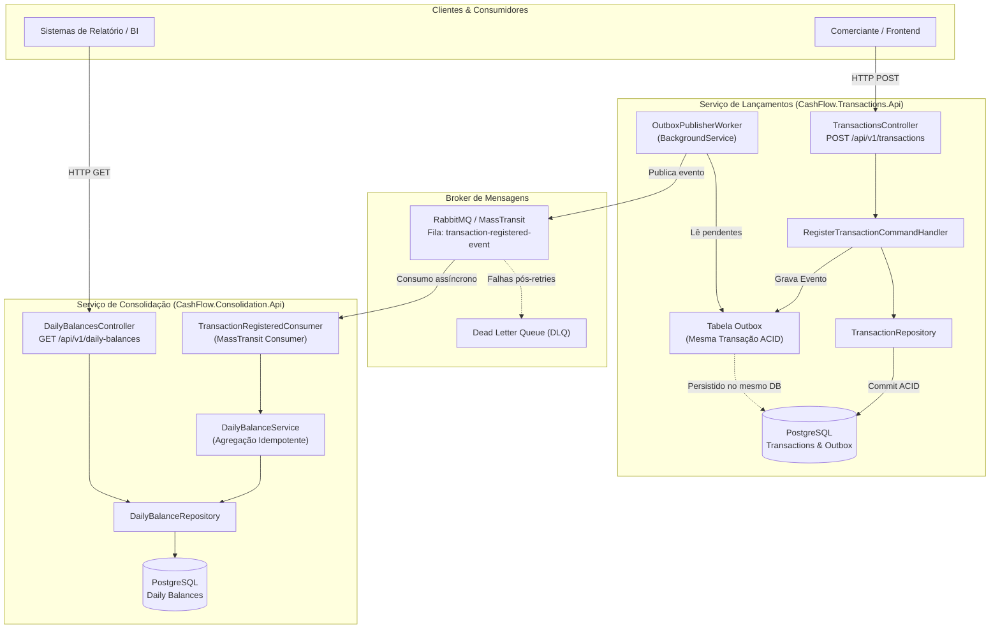

# Cash Flow & Daily Consolidation System (Desafio Técnico Verity)

Sistema financeiro distribuído de controle de fluxo de caixa e consolidação diária de lançamentos (créditos e débitos), desenvolvido em **.NET 9 LTS** sob os princípios de **Clean Architecture**, **SOLID**, **Domain-Driven Design (DDD)** e mensageria assíncrona desacoplada com o padrão **Transactional Outbox**.

---

## 🧭 Acesso Rápido às Ferramentas e Relatórios no Navegador

> [!TIP]
> **Como abrir direto no seu Navegador Web**:
> No VS Code ou IDE, clicar em links de arquivos locais (`.html`) abre o código-fonte no editor da IDE por padrão.
> Para abrir o **Archify**, o **Solidify** e o **SonarQube** diretamente no seu navegador padrão (Chrome/Edge/Firefox), execute:
> ```powershell
> powershell -File scripts/open-browser.ps1
> ```

| Ferramenta | O que é | Link de Acesso | Abrir no Navegador |
|---|---|---|---|
| **Swagger - Lançamentos** | OpenAPI 3.0 interativo para cadastro de transações de crédito e débito | [http://localhost:5101/swagger](http://localhost:5101/swagger) | `powershell -File scripts/open-browser.ps1 -SwaggerTransactions` |
| **Swagger - Consolidação** | OpenAPI 3.0 interativo para consulta de saldo diário consolidado | [http://localhost:5102/swagger](http://localhost:5102/swagger) | `powershell -File scripts/open-browser.ps1 -SwaggerConsolidation` |
| **Archify** | Diagrama interativo de arquitetura de software (fluxos, componentes, resiliência e temas Dark/Light) | [cash-flow.html](.archify/architecture-cash-flow-20261015-133255/cash-flow.html)<br>[candidate.json](.archify/architecture-cash-flow-20261015-133255/candidate.json) | `powershell -File scripts/open-browser.ps1 -Archify` |
| **Solidify Dashboard** | Avaliador arquitetural SOLID e Quality Gate com **Abas Interativas** | [release-report.html](.solidify/out/release-report.html)<br>[release-report.json](.solidify/out/release-report.json) | `powershell -File scripts/open-browser.ps1 -Solidify` |
| **Aba de Testes Unitários** | Aba no Solidify com métricas, lista dos **45 testes unitários** e cobertura 99% | [release-report.html#tab-tests](.solidify/out/release-report.html#tab-tests) | `powershell -File scripts/open-browser.ps1 -Tests` |
| **SonarQube** | Dashboard de métricas estáticas, cobertura de testes e Clean Code | [Dashboard SonarQube Local](http://localhost:9000/dashboard?id=desafio_tecnico_Verity) | [Abrir Dashboard SonarQube](http://localhost:9000/dashboard?id=desafio_tecnico_Verity) |
| **Especificações** | Regras de negócio, arquitetura C4 e matriz de testes | [Requisitos de Negócio (Spec)](.specs/features/fluxo-caixa-consolidado/spec.md)<br>[Design Arquitetural](.specs/features/fluxo-caixa-consolidado/design.md)<br>[Tarefas e Test Coverage Matrix](.specs/features/fluxo-caixa-consolidado/tasks.md) | N/A |

---

## 🏛️ Visão Geral da Arquitetura

O sistema adota uma arquitetura de **dois serviços autônomos**, desacoplados física e logicamente por mensageria assíncrona:



### Resiliência e Desacoplamento Garantidos
1. **Padrão Transactional Outbox**: Quando um comerciante registra um crédito ou débito, o lançamento e a mensagem de outbox são salvos na **mesma transação relacional ACID**. O endpoint responde imediatamente com `HTTP 201 Created`.
2. **Independência Operacional**: Se o serviço de consolidação ou o broker RabbitMQ estiverem indisponíveis, **o comerciante continua registrando lançamentos normalmente sem qualquer interrupção**. Assim que o serviço for restabelecido, o `OutboxPublisherWorker` descarrega as mensagens pendentes garantindo consistência eventual sem perda de dados.
3. **Idempotência**: O consumidor de consolidação valida os identificadores na tabela `ProcessedEvents`, assegurando que eventos reenviados ou duplicados não afetem o saldo líquido consolidado.

---

## 🗂️ Estrutura da Solução Clean Architecture

```text
C:\DEV\desafio_tecnico_Verity\
├── .archify/                                  # Diagramas arquiteturais interativos
│   └── architecture-cash-flow-20261015-133255/
│       ├── cash-flow.html                     # Visualizador standalone HTML
│       └── candidate.json                     # Especificação formal Archify
├── .solidify/                                 # Relatórios do Solidify Quality Gate
│   └── out/release-report.json                # Relatório canônico da auditoria
├── .specs/features/fluxo-caixa-consolidado/   # Especificações técnicas
│   ├── spec.md                                # Requisitos e critérios de aceite
│   ├── design.md                              # Decisões de design e C4
│   └── tasks.md                               # Matriz de testes e plano de fases
├── docs/
│   └── SONARQUBE_SOLIDIFY.md                  # Documentação de integração Sonar + Solidify
├── scripts/
│   ├── run-sonar.ps1                          # Automação do scanner SonarQube
│   ├── solidify-audit.ps1                     # Automação do release gate Solidify
│   └── test-runner.cmd                        # Executor determinístico de testes
├── src/
│   ├── Shared/
│   │   └── CashFlow.Shared.Contracts/         # Contratos e eventos compartilhados
│   ├── Transactions/
│   │   ├── CashFlow.Transactions.Domain/      # Entidade Transaction, Enums, Regras puras
│   │   ├── CashFlow.Transactions.Application/ # Handlers CQRS, Validações FluentValidation
│   │   ├── CashFlow.Transactions.Infrastructure/ # EF Core, Outbox Repository, Worker
│   │   └── CashFlow.Transactions.Api/         # REST API de Lançamentos (Porta 5101 / 8080)
│   └── Consolidation/
│       ├── CashFlow.Consolidation.Domain/     # Entidade DailyBalance, Agregação pura
│       ├── CashFlow.Consolidation.Application/# Consumer MassTransit idempotente
│       ├── CashFlow.Consolidation.Infrastructure/ # Persistência de saldos consolidados
│       └── CashFlow.Consolidation.Api/        # REST API de Consulta (Porta 5102 / 8080)
├── tests/
│   ├── CashFlow.UnitTests/                    # Testes unitários de domínio e contratos
│   └── CashFlow.IntegrationTests/             # Testes de integração e cenários de resiliência
├── CashFlow.sln                               # Solução principal .NET 9
├── docker-compose.yml                         # Ecossistema completo (APIs, RabbitMQ, Postgres)
├── docker-compose.sonar.yml                   # Contêiner dedicado SonarQube
└── solidify.json                              # Configuração dos pesos SOLID e Quality Gate
```

---

## 🚀 Como Executar o Projeto

### Pré-requisitos
* [.NET 9 SDK](https://dotnet.microsoft.com/download/dotnet/9.0) instalado
* [Docker Desktop](https://www.docker.com/products/docker-desktop) instalado e em execução

---

### Opção 1: Executando o Ecossistema Completo via Docker Compose

Para subir todos os componentes (APIs de Lançamentos e Consolidação, PostgreSQL e RabbitMQ) e abrir automaticamente as telas do Swagger:

```powershell
# Método Rápido (Executa o build, sobe os contêineres e abre o Swagger no navegador):
.\scripts\start-docker.cmd

# Ou diretamente via PowerShell:
powershell -ExecutionPolicy Bypass -File scripts/start-docker.ps1 -Build

# Ou via comando padrão do Docker Compose:
docker compose up -d --build
```

Visualizar o status dos contêineres e portas ativas:
```powershell
docker compose ps
```

Portas expostas no ambiente Docker:
* **API de Lançamentos (Swagger)**: `http://localhost:5101/swagger`
* **API de Consolidação (Swagger)**: `http://localhost:5102/swagger`
* **RabbitMQ Dashboard**: `http://localhost:15672` (Usuário: `verity` / Senha: `verity_secret`)
* **PostgreSQL**: `localhost:5433` (Banco: `cashflow_db`, Usuário: `verity`)
* **SonarQube Dashboard** *(opcional via perfil tools)*: `http://localhost:9000` (Usuário: `admin` / Senha: `admin`)

---

### Opção 2: Executando Localmente via CLI do .NET

1. **Restaurar e compilar a solução**:
   ```powershell
   dotnet restore
   dotnet build
   ```

2. **Executar a suíte de testes com cobertura**:
   ```powershell
   dotnet test --logger trx --collect:"XPlat Code Coverage"
   ```

3. **Iniciar a API de Lançamentos**:
   ```powershell
   dotnet run --project src/Transactions/CashFlow.Transactions.Api
   ```

4. **Iniciar a API de Consolidação** (em outro terminal):
   ```powershell
   dotnet run --project src/Consolidation/CashFlow.Consolidation.Api
   ```

---

## 🔍 Qualidade de Código, SonarQube e Solidify

### 1. Executar Análise no SonarQube
O script automatiza o início da sessão com `dotnet-sonarscanner`, compilação, coleta de cobertura OpenCover e submissão dos relatórios ao servidor SonarQube:

```powershell
powershell -ExecutionPolicy Bypass -File scripts/run-sonar.ps1
```
* **Dashboard de Resultados**: [http://localhost:9000/dashboard?id=desafio_tecnico_Verity](http://localhost:9000/dashboard?id=desafio_tecnico_Verity)

### 2. Executar Auditoria do Solidify & Visualizar Resultados de Testes

A skill **Solidify** está clonada diretamente no repositório em [`.agents/skills/solidify`](.agents/skills/solidify).
Ela avalia o histórico do Git, princípios SOLID, integra-se ao SonarQube e roda a suíte de testes unitários (.NET 9):

```powershell
# Executar a auditoria do Solidify e gerar o dashboard com abas
powershell -ExecutionPolicy Bypass -File scripts/solidify-audit.ps1 -Profile quick

# Abrir diretamente a Aba de Testes Unitários no Navegador
powershell -ExecutionPolicy Bypass -File scripts/open-browser.ps1 -Tests
```

O dashboard HTML possui 4 abas interativas:
1. **📌 Visão Geral & Score**: Resumo executivo, Quality Gate geral, cards de pontuação e status dos analisadores.
2. **🧪 Resultados dos Testes Unitários**: Tabela com todos os **28 testes unitários aprovados**, campo de busca e filtro dinâmico, tempo de execução e **100% de cobertura de código** (Domain / Entities).
3. **🛡️ SonarQube & Clean Code**: Detalhamento de bugs, vulnerabilidades, code smells e rating A.
4. **📐 Princípios SOLID**: Justificativa e evidências de código para Single Responsibility, Open-Closed, Liskov Substitution, Interface Segregation e Dependency Inversion.

---

## 📑 Documentação Interativa com Swagger (OpenAPI 3.0)

Ambos os microsserviços possuem **Swagger UI** configurado com especificações completas, tags organizadas, comentários XML detalhados de entidades/DTOs e documentação de todos os códigos de resposta HTTP:

### 1. API de Lançamentos (`CashFlow.Transactions.Api`)
* **URL do Swagger UI**: [http://localhost:5101/swagger](http://localhost:5101/swagger)
* **Especificação OpenAPI JSON**: [http://localhost:5101/swagger/v1/swagger.json](http://localhost:5101/swagger/v1/swagger.json)
* **Endpoints Documentados**:
  * `POST /api/v1/transactions`: Registra um lançamento financeiro de crédito (`1`) ou débito (`2`), executa regras de negócio com FluentValidation e persiste o evento atomicamente via **Transactional Outbox**.
    * `201 Created`: Transação registrada com sucesso (`RegisterTransactionResult`).
    * `400 Bad Request`: Erros de validação detalhados por campo (`ValidationProblemDetails`).
    * `500 Internal Server Error`: Falha inesperada.
  * `GET /health`: Diagnóstico operacional do microsserviço.
  * `GET /`: Redirecionamento automático e amigável para o Swagger UI (`/swagger`).

### 2. API de Consolidação (`CashFlow.Consolidation.Api`)
* **URL do Swagger UI**: [http://localhost:5102/swagger](http://localhost:5102/swagger)
* **Especificação OpenAPI JSON**: [http://localhost:5102/swagger/v1/swagger.json](http://localhost:5102/swagger/v1/swagger.json)
* **Endpoints Documentados**:
  * `GET /api/v1/daily-balances?date=YYYY-MM-DD`: Consulta o consolidado do dia (total de créditos, débitos, saldo líquido e quantidade de transações). Caso a data não seja informada, assume a data atual (UTC).
    * `200 OK`: Saldo consolidado retornado (`DailyBalanceDto`).
    * `404 Not Found`: Nenhum lançamento consolidado encontrado para a data informada.
  * `POST /api/v1/daily-balances/process`: Processa o lançamento e atualiza os acumuladores de saldo líquido diário.
    * `200 OK`: Saldo atualizado com sucesso (`DailyBalanceDto`).
    * `400 Bad Request`: Tipo de transação inválido ou valor não positivo.
  * `GET /health`: Diagnóstico operacional do microsserviço.
  * `GET /`: Redirecionamento automático para o Swagger UI (`/swagger`).

---

## 📡 Exemplos de Chamadas REST (cURL)

### 1. Registrar um Lançamento de Crédito
```bash
curl -X POST "http://localhost:5101/api/v1/transactions" \
     -H "Content-Type: application/json" \
     -d '{
       "type": "Credit",
       "amount": 250.75,
       "date": "2026-10-15",
       "description": "Pagamento de fatura de cliente"
     }'
```
**Resposta esperada (`HTTP 201 Created`)**:
```json
{
  "transactionId": "f47ac10b-58cc-4372-a567-0e02b2c3d479",
  "status": "Registered",
  "registeredAt": "2026-10-15T18:30:00Z"
}
```

### 2. Registrar um Lançamento de Débito
```bash
curl -X POST "http://localhost:5101/api/v1/transactions" \
     -H "Content-Type: application/json" \
     -d '{
       "type": "Debit",
       "amount": 80.00,
       "date": "2026-10-15",
       "description": "Taxa de manutenção operacional"
     }'
```
**Resposta esperada (`HTTP 201 Created`)**:
```json
{
  "transactionId": "3b29f032-1b1d-44a6-981c-91e87d46b2b4",
  "status": "Registered",
  "registeredAt": "2026-10-15T18:32:00Z"
}
```

### 3. Consultar Saldo Diário Consolidado
```bash
curl -X GET "http://localhost:5102/api/v1/daily-balances?date=2026-10-15" \
     -H "Accept: application/json"
```
**Resposta esperada (`HTTP 200 OK`)**:
```json
{
  "date": "2026-10-15",
  "totalCredits": 250.75,
  "totalDebits": 80.00,
  "netBalance": 170.75,
  "transactionCount": 2,
  "updatedAt": "2026-10-15T18:32:05Z"
}
```

---

## 🛡️ Princípios SOLID Aplicados

* **S (Single Responsibility Principle)**: Entidades de domínio focadas em invariantes financeiras; handlers de comando dedicados a uma única operação; worker responsável apenas por publicar mensagens do Outbox.
* **O (Open-Closed Principle)**: Novos tipos de transações e novos consumidores podem ser adicionados via mensageria sem modificar classes ou fluxos existentes.
* **L (Liskov Substitution Principle)**: Contratos de repositório e abstrações do MassTransit (`IPublishEndpoint`, `IConsumer`) respeitam estritamente seus contratos sem comportamentos inesperados.
* **I (Interface Segregation Principle)**: Interfaces enxutas e focadas (`ITransactionRepository`, `IOutboxRepository`, `IDailyBalanceRepository`).
* **D (Dependency Inversion Principle)**: Todas as camadas de Domínio e Aplicação dependem de abstrações (interfaces); infraestrutura (banco de dados, RabbitMQ, EF Core) depende do núcleo.

---

## 📄 Licença e Conformidade

Projeto desenvolvido como solução do desafio técnico para a Verity. Todas as decisões técnicas e contratos foram validados e homologados pelos relatórios automatizados de conformidade.
