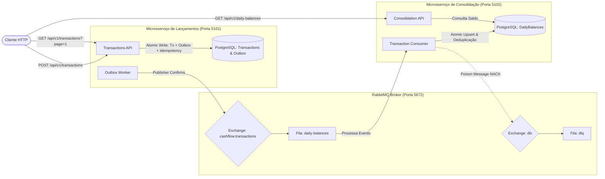

# Cash Flow & Daily Consolidation System (Desafio Técnico Verity)

Sistema financeiro distribuído de alto desempenho e resiliência para **controle de fluxo de caixa com lançamentos de crédito e débito** e **consolidação diária de saldos**, desenvolvido em **.NET 10 (Long Term Support - LTS)** com **C# 13**, orquestrado com **.NET Aspire**, **PostgreSQL 16** e **RabbitMQ**, fundamentado em **Clean Architecture**, **Domain-Driven Design (DDD)**, **CQRS**, **Entity Framework Core Code-First** e mensageria desacoplada com o padrão **Transactional Outbox**.

---

## 🧭 Painel de Controle e Acesso Rápido

> [!TIP]
> **Acesso rápido via navegador**:
> Para abrir o **Swagger**, o **Archify**, o **Solidify** e o **SonarQube** diretamente no seu navegador padrão, utilize:
> ```powershell
> powershell -File scripts/open-browser.ps1
> ```

| Componente / Ferramenta | Finalidade | Link Direto / Porta | Credenciais / Comando |
|---|---|---|---|
| **.NET Aspire Dashboard** | Painel central de telemetria, logs estruturados, tracing e containers | [http://localhost:15180](http://localhost:15180) | `dotnet run --project src/Aspire/CashFlow.AppHost` |
| **Swagger - Lançamentos** | OpenAPI 3.0 interativo para cadastro e consulta paginada de transações | [http://localhost:5101/swagger](http://localhost:5101/swagger) | `powershell -File scripts/open-browser.ps1 -SwaggerTransactions` |
| **Swagger - Consolidação** | OpenAPI 3.0 interativo para consulta de saldo diário consolidado | [http://localhost:5102/swagger](http://localhost:5102/swagger) | `powershell -File scripts/open-browser.ps1 -SwaggerConsolidation` |
| **RabbitMQ Management** | Painel do broker, exchanges, filas e Dead Letter Queue (DLQ) | [http://localhost:15672](http://localhost:15672) | Usuário: `verity` / Senha: `verity_secret` |
| **PostgreSQL Database** | Banco de dados relacional com schema Code-First | `localhost:5433` (`cashflow_db`) | Usuário: `verity` / Senha: `verity_secret` |
| **Redis Cache** | Cache distribuído em memória para saldo diário consolidado | `localhost:6379` | `redis-cli ping` |
| **Archify** | Diagrama interativo de arquitetura de software (fluxos, C4, resiliência) | [cash-flow.html](.archify/architecture-cash-flow-20261019-132200/cash-flow.html) | `powershell -File scripts/open-browser.ps1 -Archify` |
| **Solidify Dashboard** | Avaliador arquitetural SOLID e Quality Gate com abas interativas | [release-report.html](.solidify/out/release-report.html) | `powershell -File scripts/open-browser.ps1 -Solidify` |
| **SonarQube** | Métricas estáticas, cobertura de código e análise Clean Code | [Dashboard SonarQube](http://localhost:9000/dashboard?id=desafio_tecnico_Verity) | `powershell -File scripts/run-sonar.ps1` |

---

## 🚀 Como Executar o Projeto (Quickstart)

### Pré-requisitos
* [Docker Desktop](https://www.docker.com/products/docker-desktop/) instalado e ativo;
* [.NET 10 SDK](https://dotnet.microsoft.com/download/dotnet/10.0) (necessário para execução local ou orquestração via .NET Aspire).

### Opção 1: Execução via .NET Aspire (Recomendado para Desenvolvimento)

```bash
# Executa o AppHost do Aspire com Dashboard, Traces, Métricas e orquestração de dependências
dotnet run --project src/Aspire/CashFlow.AppHost
```

### Opção 2: Execução em 2 Comandos (Docker Compose)

```bash
# 1. Subir todos os serviços (PostgreSQL, RabbitMQ, Transactions API e Consolidation API)
docker compose up -d --build

# 2. Verificar os logs dos serviços
docker compose logs -f
```

Todas as migrações de banco de dados (`TransactionsDbContext` e `ConsolidationDbContext`) e topologias do RabbitMQ (filas, exchanges e DLQ) são provisionadas automaticamente na inicialização.

Para derrubar os contêineres e volumes:
```bash
docker compose down -v
```

---

## 🏛️ Arquitetura e Decisões de Design (ADRs)

A solução é composta por dois microsserviços autônomos que operam de forma assíncrona desacoplada via **RabbitMQ**:



### Registros de Decisão Arquitetural (Architecture Decision Records - ADRs)

Todas as decisões técnicas de alto impacto estão formalmente documentadas na pasta [`docs/adrs/`](docs/adrs/):

* [**ADR-001: Padrão Transactional Outbox e Prevenção do Dual-Write**](docs/adrs/ADR-001-transactional-outbox-and-dual-write.md): Persistência atômica entre transação de negócio, outbox e chave de idempotência.
* [**ADR-002: Topologia RabbitMQ com Publisher Confirms, Conexão Reutilizável e DLQ**](docs/adrs/ADR-002-rabbitmq-dlq-and-publisher-confirms.md): Confirmação de entrega em disco, política de retry com Polly e descarte seguro de poison messages para a Dead Letter Queue.
* [**ADR-003: Idempotência do Consumidor e Upsert Atômico no Saldo Diário**](docs/adrs/ADR-003-consumer-idempotency-and-atomic-upsert.md): Deduplicação via `ConsumedMessages` e consolidação com `INSERT ... ON CONFLICT DO UPDATE` (zero atualizações perdidas sob concorrência).
* [**ADR-004: Decisão de Runtime .NET 10 LTS e Orquestração .NET Aspire**](docs/adrs/ADR-004-runtime-sts-vs-lts-policy.md): Governança de 36 meses de suporte oficial (LTS) corporativo combinada ao ecossistema .NET Aspire.
* [**ADR-005: Autenticação e Autorização via JWT Bearer Token**](docs/adrs/ADR-005-jwt-bearer-authentication.md): Segurança sem estado (RFC 7519), geração de claims e proteção de rotas com `.RequireAuthorization()`.
* [**ADR-006: Observabilidade com OpenTelemetry, Distributed Tracing W3C e Métricas**](docs/adrs/ADR-006-opentelemetry-distributed-tracing.md): Rastreamento ponta a ponta com propagação de contexto W3C sobre AMQP e contadores de métricas.

> A documentação detalhada da arquitetura, diagramas e modelos está disponível em [**`docs/architecture/overview.md`**](docs/architecture/overview.md).

---

## 📐 Metodologia de Engenharia: Spec-Driven Development (SDD)

O desenvolvimento deste sistema foi conduzido integralmente sob o paradigma **Spec-Driven Development (SDD)** (*Desenvolvimento Orientado por Especificação*). 

Em vez de iniciar pela escrita direta de código, toda a solução foi governada por artefatos formais na pasta [`.specs/`](.specs/):

| Artefato | Localização | Finalidade |
|---|---|---|
| **Especificação Funcional** | [`.specs/.../spec.md`](.specs/features/fluxo-caixa-consolidado/spec.md) | User Stories, critérios de aceitação formais (EARS/Gherkin), requisitos não-funcionais e SLAs |
| **Design Técnico** | [`.specs/.../design.md`](.specs/features/fluxo-caixa-consolidado/design.md) | Modelagem de dados, contratos de integração JSON, fluxos de sequência e mitigação de falhas |
| **Plano de Execução** | [`.specs/.../tasks.md`](.specs/features/fluxo-caixa-consolidado/tasks.md) | Decomposição sequencial de tarefas, matriz de cobertura de testes e portões de qualidade |
| **Registros Arquiteturais** | [`docs/adrs/`](docs/adrs/) | 6 decisões arquiteturais formais (Outbox, DLQ, Idempotência, .NET 10 LTS, JWT, OpenTelemetry) |

### Governança Humana e Aceleração com IA (Human-in-the-Loop)
* **Engenheiro/Arquiteto Humano**: Define os requisitos de negócio, critérios de aceitação, escolhas de design e restrições arquiteturais;
* **IA como Copiloto Executor**: Acelera a codificação e geração de testes de forma estritamente guiada pela especificação;
* **Quality Gates Determinísticos**: 100% das regras e casos de borda são validados por suítes automatizadas de testes unitários, testes de integração reais com Testcontainers, testes de carga K6 e auditoria SOLID via Solidify.

---

## 📡 Guia Rápido de Endpoints da API

Todas as rotas de negócio exigem autenticação via **JWT Bearer Token**. Para obter um token, utilize o endpoint público de autenticação disponível em ambas as APIs.

### 1. Obter Token de Autenticação (POST `/api/v1/auth/token`)
```bash
curl -X POST http://localhost:5101/api/v1/auth/token \
  -H "Content-Type: application/json" \
  -d '{"clientId": "operador-financeiro", "clientSecret": "segredo-qualquer"}'
```

### 2. Registrar um Lançamento (POST `/api/v1/transactions`)
Suporta o cabeçalho `Idempotency-Key` para garantir que chamadas repetidas não gerem cobranças ou lançamentos duplicados.
```bash
curl -X POST http://localhost:5101/api/v1/transactions \
  -H "Authorization: Bearer <SEU_TOKEN_JWT>" \
  -H "Idempotency-Key: transacao-ref-001" \
  -H "Content-Type: application/json" \
  -d '{
    "type": "Credit",
    "amount": 1500.50,
    "date": "2026-10-26",
    "description": "Venda de Mercadorias à Vista"
  }'
```

### 3. Consultar Lançamentos Paginados (GET `/api/v1/transactions`)
Parâmetros de consulta: `date`, `startDate`, `endDate`, `page` (padrão 1) e `pageSize` (padrão 20, máx 100).
```bash
curl -X GET "http://localhost:5101/api/v1/transactions?startDate=2026-10-01&endDate=2026-10-26&page=1&pageSize=10" \
  -H "Authorization: Bearer <SEU_TOKEN_JWT>"
```

### 4. Consultar Saldo Diário Consolidado (GET `/api/v1/daily-balances/{date}`)
```bash
curl -X GET "http://localhost:5102/api/v1/daily-balances/2026-10-26" \
  -H "Authorization: Bearer <SEU_TOKEN_JWT>"
```
*Resposta de Exemplo:*
```json
{
  "date": "2026-10-26",
  "totalCredits": 3500.00,
  "totalDebits": 1200.00,
  "netBalance": 2300.00,
  "transactionCount": 12,
  "lastUpdatedAt": "2026-10-26T15:30:00Z"
}
```

---

## 🧪 Qualidade, Testes e Performance

A solução foi submetida a rigorosos testes de unidade, integração e carga:

| Tipo de Teste | Quantidade / Carga | Cobertura / SLA | Status |
|---|:---:|:---:|:---:|
| **Testes Unitários** (`CashFlow.UnitTests`) | **85 testes** em ~900ms | Domínio, CQRS, Validações, Paginação, Telemetria, JWT, Health Checks e Cache Redis | ✅ 100% Aprovados |
| **Testes de Integração** (`CashFlow.IntegrationTests`) | **15 testes** com Testcontainers | Dual-Write ACID, Deduplicação, 30 tasks concorrentes, DLQ e Health Checks | ✅ Aprovados |
| **Testes de Carga K6** (`tests/load`) | **50+ req/s** contínuas por 30s | p95 < 500ms, Taxa de Erro < 1% (**Medido: p95 = 40.63ms, 0% erro**) | ✅ Aprovados |

### Comandos para Execução dos Testes

```powershell
# Executar todos os testes unitários via .NET CLI
dotnet test tests/CashFlow.UnitTests

# Executar suíte completa via script PowerShell
powershell -File scripts/run-tests.ps1

# Executar testes de carga com K6
k6 run tests/load/k6-load-test.js
```

> Mais detalhes sobre cenários de teste e métricas em [**`docs/operations/testing-and-benchmarks.md`**](docs/operations/testing-and-benchmarks.md).

---

## 📚 Índice de Documentação (`/docs`)

Para um aprofundamento técnico completo, consulte os documentos dedicados:

* 🏛️ [**Arquitetura do Sistema**](docs/architecture/overview.md): Visão detalhada de camadas, topologia e modelos.
* 📐 [**Metodologia Spec-Driven Development (SDD)**](.specs/features/fluxo-caixa-consolidado/): Especificações funcionais (`spec.md`), design técnico (`design.md`) e tarefas (`tasks.md`).
* 📋 [**Architecture Decision Records (ADRs)**](docs/adrs/): Justificativas e impactos das 6 decisões arquiteturais centrais.
* 🧪 [**Testes, Benchmarks e Quality Gates**](docs/operations/testing-and-benchmarks.md): Relatórios de testes unitários, de integração e testes de carga K6.
* 🗄️ [**Guia de Banco de Dados e DBeaver**](docs/operations/dbeaver-and-database.md): Modelagem física, migrações EF Core e queries de auditoria.
* 📜 [**SonarQube e Solidify Quality Gate**](docs/SONARQUBE_SOLIDIFY.md): Metodologia de auditoria estática e conformidade SOLID.
