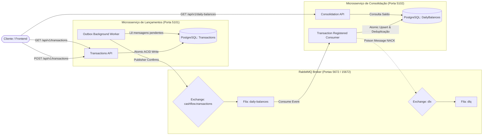

# Arquitetura do Sistema CashFlow

## 1. Visão Geral e Princípios Arquiteturais

O sistema **CashFlow** foi concebido para atender a um cenário financeiro crítico de controle de fluxo de caixa com lançamentos de crédito e débito e consolidação contínua de saldos diários.

A solução é orientada pelos seguintes pilares de engenharia:
* **Clean Architecture**: Separação estrita de responsabilidades entre regras de negócio corporativas, orquestração de casos de uso, adaptadores de infraestrutura e camadas de apresentação.
* **Domain-Driven Design (DDD)**: Entidades ricas com invariantes de negócio protegidas, métodos de fábrica explícitos e isolamento do domínio contra frameworks externos.
* **CQRS (Command Query Responsibility Segregation)**: Separação entre operações mutacionais de escrita (Commands) e consultas de leitura (Queries).
* **Consistência Eventual e Desacoplamento Assíncrono**: O serviço de lançamentos opera de forma autônoma e independente da disponibilidade do serviço de consolidação diária.

---

## 2. Topologia dos Microsserviços

O ecossistema é composto por dois microsserviços autônomos que se comunicam de forma desacoplada via **RabbitMQ**:



---

## 3. Modelo de Dados Relacional (PostgreSQL)

O banco de dados relacional utiliza o schema `public` com tabelas estruturadas via Code-First:

### Tabelas do Microsserviço de Lançamentos
1. **`Transactions`**: Registros imutáveis de movimentação contábil.
   * `Id` (UUID, PK)
   * `Type` (integer: 1 = Credit, 2 = Debit)
   * `Amount` (numeric(18,2))
   * `Date` (date)
   * `Description` (varchar(255))
   * `CreatedAt` (timestamptz)
2. **`OutboxMessages`**: Tabela de despacho do Transactional Outbox.
   * `Id` (UUID, PK)
   * `EventType` (varchar(100))
   * `Payload` (text JSON)
   * `CreatedAt` (timestamptz)
   * `ProcessedAt` (timestamptz, nullable)
   * `RetryCount` (integer)
   * `ErrorMessage` (text, nullable)
3. **`IdempotencyRecords`**: Deduplicação de requisições HTTP na API de lançamentos.
   * `Key` (varchar(128), PK)
   * `TransactionId` (UUID)
   * `ResponsePayload` (text JSON)
   * `StatusCode` (integer)
   * `CreatedAt` (timestamptz)

### Tabelas do Microsserviço de Consolidação
1. **`DailyBalances`**: Agregação contínua do saldo por dia contábil.
   * `Date` (date, PK)
   * `TotalCredits` (numeric(18,2))
   * `TotalDebits` (numeric(18,2))
   * `NetBalance` (numeric(18,2) = TotalCredits - TotalDebits)
   * `TransactionCount` (integer)
   * `LastUpdatedAt` (timestamptz)
2. **`ConsumedMessages`**: Deduplicação e proteção contra reentregas de eventos.
   * `TransactionId` (UUID, PK)
   * `ConsumedAt` (timestamptz)

---

## 4. Estrutura de Camadas (Clean Architecture)

```text
src/
├── Shared/
│   └── CashFlow.Shared.Contracts/       # Contratos de DTOs, Eventos, Contextos e Telemetria
├── Transactions/
│   ├── CashFlow.Transactions.Domain/          # Entidades (Transaction, OutboxMessage, IdempotencyRecord)
│   ├── CashFlow.Transactions.Application/     # Commands, Queries, DTOs, Handlers e Validadores Fluent
│   ├── CashFlow.Transactions.Infrastructure/  # EF Core DbContext, Repositórios e Mapeamentos
│   └── CashFlow.Transactions.Api/             # Minimal APIs, Workers em Background e Telemetria
└── Consolidation/
    ├── CashFlow.Consolidation.Domain/         # Entidades (DailyBalance, ConsumedMessage)
    ├── CashFlow.Consolidation.Application/    # DTOs, Serviços de Consolidação e Cálculos
    ├── CashFlow.Consolidation.Infrastructure/ # EF Core DbContext, Upsert Atômico SQL e Repositórios
    └── CashFlow.Consolidation.Api/            # Minimal APIs, RabbitMQ Consumer Worker e Telemetria
```
