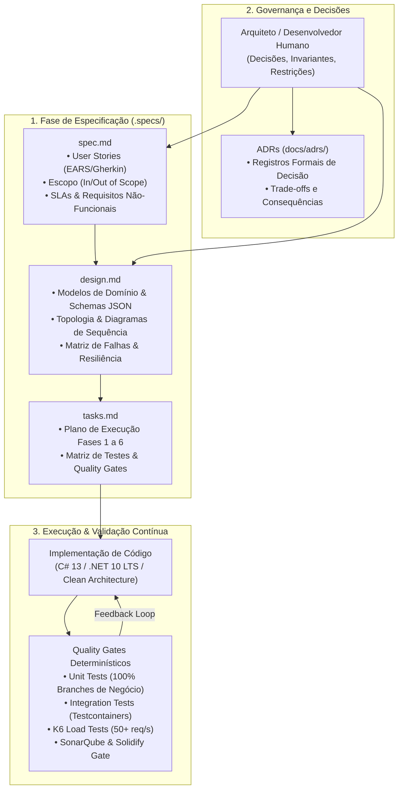

# Arquitetura do Sistema CashFlow

## 1. Visão Geral e Princípios Arquiteturais

O sistema **CashFlow** foi concebido para atender a um cenário financeiro crítico de controle de fluxo de caixa com lançamentos de crédito e débito e consolidação contínua de saldos diários.

A solução é orientada pelos seguintes pilares de engenharia:
* **Clean Architecture**: Separação estrita de responsabilidades entre regras de negócio corporativas, orquestração de casos de uso, adaptadores de infraestrutura e camadas de apresentação.
* **Domain-Driven Design (DDD)**: Entidades ricas com invariantes de negócio protegidas, métodos de fábrica explícitos e isolamento do domínio contra frameworks externos.
* **CQRS (Command Query Responsibility Segregation)**: Separação entre operações mutacionais de escrita (Commands) e consultas de leitura (Queries).
* **Consistência Eventual e Desacoplamento Assíncrono**: O serviço de lançamentos opera de forma autônoma e independente da disponibilidade do serviço de consolidação diária.

---

## 2. Topologia dos Microsserviços

O ecossistema é composto por dois microsserviços autônomos que se comunicam de forma desacoplada via **RabbitMQ**:


### Orquestração Cloud-Native com .NET Aspire (`src/Aspire/CashFlow.AppHost`)

O projeto implementa orquestração moderna via **.NET Aspire 13** em .NET 10 LTS:
* **Execução dos Microsserviços**: As APIs rodam como **processos nativos do sistema operacional**, proporcionando Hot Reload, consumo reduzido de memória e depuração transparente no IDE;
* **Gerenciamento de Infraestrutura**: Contêineres de PostgreSQL, RabbitMQ e Redis são provisionados automaticamente com volumes persistentes (`ContainerLifetime.Persistent`), garantindo que dados e filas sejam mantidos entre reinicializações;
* **Descoberta e Injeção de Dependências**: Comunicação tipada e injeção automática de connection strings via `.WithReference(...)`;
* **Observabilidade Unificada**: Painel do Aspire Dashboard na porta **15180**, centralizando traces OpenTelemetry W3C, métricas em tempo real e logs de todos os nós do sistema.

---

## 3. Modelo de Dados Relacional (PostgreSQL)

O banco de dados relacional utiliza o schema `public` com tabelas estruturadas via Code-First:

### Tabelas do Microsserviço de Lançamentos
1. **`Transactions`**: Registros imutáveis de movimentação contábil.
   * `Id` (UUID, PK)
   * `Type` (integer: 1 = Credit, 2 = Debit)
   * `Amount` (numeric(18,2))
   * `Date` (date)
   * `Description` (varchar(255))
   * `CreatedAt` (timestamptz)
2. **`OutboxMessages`**: Tabela de despacho do Transactional Outbox.
   * `Id` (UUID, PK)
   * `EventType` (varchar(100))
   * `Payload` (text JSON)
   * `CreatedAt` (timestamptz)
   * `ProcessedAt` (timestamptz, nullable)
   * `RetryCount` (integer)
   * `ErrorMessage` (text, nullable)
3. **`IdempotencyRecords`**: Deduplicação de requisições HTTP na API de lançamentos.
   * `Key` (varchar(128), PK)
   * `TransactionId` (UUID)
   * `ResponsePayload` (text JSON)
   * `StatusCode` (integer)
   * `CreatedAt` (timestamptz)

### Tabelas do Microsserviço de Consolidação
1. **`DailyBalances`**: Agregação contínua do saldo por dia contábil.
   * `Date` (date, PK)
   * `TotalCredits` (numeric(18,2))
   * `TotalDebits` (numeric(18,2))
   * `NetBalance` (numeric(18,2) = TotalCredits - TotalDebits)
   * `TransactionCount` (integer)
   * `LastUpdatedAt` (timestamptz)
2. **`ConsumedMessages`**: Deduplicação e proteção contra reentregas de eventos.
   * `TransactionId` (UUID, PK)
   * `ConsumedAt` (timestamptz)

---

## 4. Estrutura de Camadas (Clean Architecture)

```text
src/
├── Shared/
│   └── CashFlow.Shared.Contracts/       # Contratos de DTOs, Eventos, Contextos e Telemetria
├── Transactions/
│   ├── CashFlow.Transactions.Domain/          # Entidades (Transaction, OutboxMessage, IdempotencyRecord)
│   ├── CashFlow.Transactions.Application/     # Commands, Queries, DTOs, Handlers e Validadores Fluent
│   ├── CashFlow.Transactions.Infrastructure/  # EF Core DbContext, Repositórios e Mapeamentos
│   └── CashFlow.Transactions.Api/             # Minimal APIs, Workers em Background e Telemetria
└── Consolidation/
    ├── CashFlow.Consolidation.Domain/         # Entidades (DailyBalance, ConsumedMessage)
    ├── CashFlow.Consolidation.Application/    # DTOs, Serviços de Consolidação e Cálculos
    ├── CashFlow.Consolidation.Infrastructure/ # EF Core DbContext, Upsert Atômico SQL e Repositórios
    └── CashFlow.Consolidation.Api/            # Minimal APIs, RabbitMQ Consumer Worker e Telemetria
```

---

## 5. Metodologia de Engenharia: Spec-Driven Development (SDD)

O projeto foi inteiramente concebido e implementado sob o paradigma **Spec-Driven Development (SDD)** (*Desenvolvimento Orientado por Especificação*). 

Diferente da abordagem tradicional onde a codificação começa diretamente nos fontes ou sob documentação superficial, o SDD estabelece que **especificações formais, critérios de aceitação e contratos de design técnico devem preceder e guiar toda a implementação**.



### Artefatos Centrais do SDD no Repositório

Todos os artefatos de especificação estão versionados no diretório [`.specs/`](../../.specs/):

1. **[`spec.md`](../../.specs/features/fluxo-caixa-consolidado/spec.md) (Especificação Funcional e Regras de Negócio)**:
   * **Declaração do Problema**: Necessidade de livro-caixa com alta disponibilidade e consolidação desacoplada;
   * **Critérios de Aceitação Formais**: Especificados na sintaxe *WHEN / THEN / IF / SHALL*, cobrindo lançamentos válidos, valores negativos, descrições nulas e concorrência;
   * **Delimitação de Escopo**: O que está dentro e explicitamente fora do escopo do desafio técnico;
   * **Requisitos Não-Funcionais e SLAs**: Vazão mínima de 50 requisições/s com perda zero de eventos contábeis.

2. **[`design.md`](../../.specs/features/fluxo-caixa-consolidado/design.md) (Design Técnico e Arquitetural)**:
   * **Contratos de Dados e Eventos**: Esquema canônico do evento `TransactionRegisteredIntegrationEvent`;
   * **Matriz de Falhas e Mitigações**: Mapeamento antecipado de problemas como *Dual-Write*, *Poison Messages*, *Lost Updates* e queda do broker, definindo os padrões a adotar antes de qualquer codificação;
   * **Estratégia de Concorrência**: Deduplicação via `ConsumedMessages` e consolidação com upsert atômico relacional.

3. **[`tasks.md`](../../.specs/features/fluxo-caixa-consolidado/tasks.md) (Decomposição e Matriz de Cobertura)**:
   * Decomposição ordenada do desenvolvimento em fases sequenciais;
   * Matriz de testes obrigatórios por camada (Domínio, Aplicação, Mensageria, APIs e Carga);
   * Comandos determinísticos de validação para cada portão de qualidade (*Quality Gate*).

### Governança Humana e Aceleração com IA (Human-in-the-Loop)

No modelo SDD adotado:
* **O Engenheiro/Arquiteto Humano lidera a governança**: Define as regras de negócio, seleciona os padrões arquiteturais (Outbox, DLQ, Idempotência, LTS), valida as decisões registradas nos ADRs e audita os relatórios do Solidify e SonarQube;
* **A Inteligência Artificial atua como copiloto executor**: Acelera a geração de código, testes de unidade e integrações sob as restrições estritas da especificação;
* **Zero Alucinação / Desvio Arquitetural**: O código só é aceito se passar 100% pelos testes determinísticos e Quality Gates definidos previamente na especificação (`tasks.md`).

